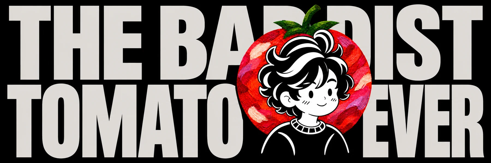
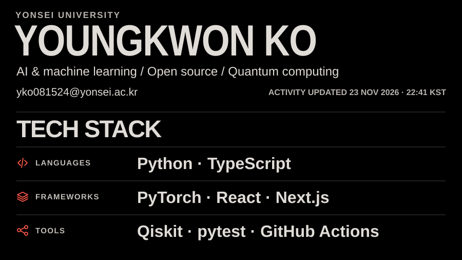
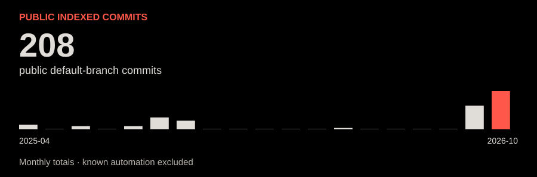

<picture>
  <source media="(max-width: 600px)" srcset="assets/static/profile-mobile.svg">
  
</picture>
<picture>
  <source media="(max-width: 600px)" srcset="assets/dynamic/public-prs-mobile.svg">
  
</picture>

<picture>
  <source media="(max-width: 600px)" srcset="assets/dynamic/commits-mobile.svg">
  
</picture>
