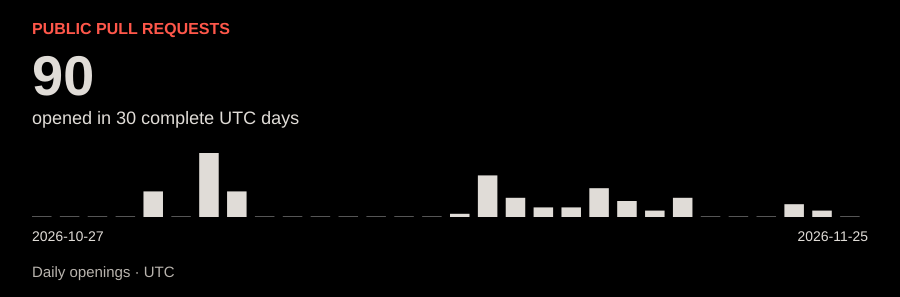

<picture>
  <source media="(max-width: 600px)" srcset="assets/static/profile-mobile.svg">
  
</picture>
<picture>
  <source media="(max-width: 600px)" srcset="assets/dynamic/public-prs-mobile.svg">
  
</picture>

<picture>
  <source media="(max-width: 600px)" srcset="assets/dynamic/commits-mobile.svg">
  
</picture>

Public PRs cover the last 30 completed UTC days. The monthly graph counts unique commits attributed to this account on indexed public default branches, from April 2025 through the last completed UTC month. Identifiable bot and LeetHub commits are excluded.

## Explore the work

**P2I** · [Core](https://github.com/PtwoI/p2i-core) · [GUI](https://github.com/PtwoI/p2i-gui) · [CLI](https://github.com/PtwoI/p2i-cli) · [SDK](https://github.com/PtwoI/p2i-sdk) 
**Architecture Atlas** · [Explore the map](https://k0ykwon.github.io/apps/p2imap/) · [Source](https://github.com/PtwoI/p2i-kg) 
**Research & applications** · [COAST circuits](https://github.com/K0ykwon/COAST) · [MINEY](https://github.com/K0ykwon/MINEY) · [MINEY demo](https://www.youtube.com/watch?v=GuP2Haq75-Y)

**Contributions** · [SamoAI CLI migration](https://github.com/little-samo/SamoAI-Example-CLI/pull/1) · [SamoAI storage types](https://github.com/little-samo/SamoAI-Repository-Storage/pull/1) · [UpstageAI Cookbook submission](https://github.com/UpstageAI/cookbook/pull/98) 
**Activity** · [Browse public PRs](https://github.com/pulls?q=is%3Apr+is%3Apublic+author%3AK0ykwon+sort%3Acreated-desc) · [Contribution calendar](https://github.com/K0ykwon)

[Portfolio](https://k0ykwon.github.io/) · [LinkedIn](https://www.linkedin.com/in/youngkwon-ko-355984390/) · [yko081524@yonsei.ac.kr](mailto:yko081524@yonsei.ac.kr)
